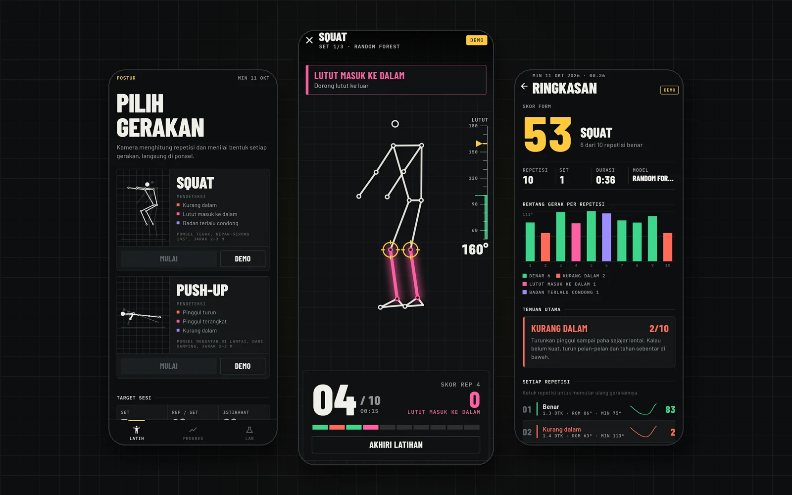

# Postur



**[Unduh APK terbaru](https://github.com/Reverseflash45/postur/releases/latest)** · Android 7.0+, arm64

Deteksi kesalahan postur **squat** dan **push-up** dari kamera ponsel. Pose
estimation (ML Kit / MediaPipe, 33 landmark BlazePose) mengubah video menjadi
deret koordinat sendi, penghitung repetisi memotongnya per repetisi, lalu satu
dari empat model menilai setiap repetisi: aturan ambang sudut, Random Forest,
1D-CNN, atau LSTM. Semuanya berjalan di perangkat.

Proyek skripsi: *Sistem Deteksi Kesalahan Postur Latihan Squat dan Push-Up
Berbasis Pose Estimation dan Klasifikasi Deret Waktu pada Perangkat Android*.

```
kamera ──► pose (33 titik) ──► segmentasi repetisi ──► fitur 64×38 / 72 ──► model ──► umpan balik suara
```

| Gerakan | Kelas |
|---|---|
| Squat (kamera depan-serong ±45°) | SQ-0 benar · SQ-1 kurang dalam · SQ-2 lutut masuk ke dalam · SQ-3 badan terlalu condong |
| Push-up (kamera dari samping) | PU-0 benar · PU-1 pinggul turun · PU-2 pinggul terangkat · PU-3 kurang dalam |

## Isi repo

```
ml/    Python: data, fitur, segmentasi, 4 model, evaluasi GroupKFold, analisis Bab IV, ekspor TFLite
app/   Flutter (Android): latihan per set, mode demo, rekam & tinjau data, uji kinerja, info model
```

### Aplikasi

- **Latih**: cek posisi (badan terlihat, jarak, diam) → hitung mundur → set dengan
  target repetisi → istirahat berwaktu. Bagian tubuh yang salah disorot di
  kerangka, koreksi diucapkan, pengukur sudut berubah hijau saat kedalaman tercapai.
- **Ringkasan**: skor form (peluang kelas benar), rentang gerak tiap repetisi,
  tempo turun/naik, temuan utama, putar ulang kerangka tiap repetisi, kartu hasil
  PNG untuk dibagikan. Dengan *Bandingkan semua model* aktif, setiap repetisi
  juga dinilai model lain dan kesepakatannya ditampilkan.
- **Progres**: repetisi 14 hari, tren skor, rekor, riwayat.
- **Lab**: rekam data, tinjau dan label ulang tiap repetisi, uji kinerja, info
  model, panduan, pengaturan.

Logika fitur dan segmentasi ditulis dua kali (Python untuk pelatihan, Dart
untuk aplikasi). `app/test/paritas_test.dart` memastikan keduanya menghasilkan
angka yang sama dengan berkas uji dari Python, sampai ±1e-8.

## Alur penelitian

1. **Rekam data** di aplikasi (menu *Rekam data*): isi kode subjek, pilih
   kelas, subjek melakukan 10 repetisi, isi hitungan manual, simpan. Data
   latih berasal dari pose estimator yang sama dengan yang dipakai saat
   aplikasi berjalan.
2. **Ekspor** semua rekaman (.zip) dari aplikasi ke laptop, lalu ekstrak ke
   `ml/data/rekaman/`.
3. **Tinjau** tiap rekaman di aplikasi (ketuk sesi di *Rekam data*): putar
   ulang tiap repetisi, ganti labelnya, atau buang yang salah diperagakan.
   Hasilnya tersimpan sebagai `label_rep` di berkas sesi. Alternatifnya di
   laptop:
   ```
   cd ml
   .venv/Scripts/python -m postur periksa --data data/rekaman --csv data/anotasi.csv
   ```
   Prioritas label: `anotasi.csv` > `label_rep` dari aplikasi > label set.
4. **Latih dan evaluasi** (5-fold GroupKFold per subjek, augmentasi, McNemar,
   kuantisasi int8):
   ```
   .venv/Scripts/python -m postur latih --data data/rekaman --anotasi data/anotasi.csv --keluar hasil
   ```
   Hasilnya di `hasil/<gerakan>/`:
   - `laporan.md` dan `metrik.json`: macro-F1, per kelas, McNemar, kuantisasi,
     penghitungan repetisi, F1 per subjek, fitur terpenting RF, kurva belajar
   - `tabel.tex`: tabel booktabs siap tempel ke Bab IV
   - PNG: confusion matrix tiap model, F1 per subjek, fitur penting, kurva belajar

   Kurva belajar bisa dilewati dengan `--tanpa-kurva`.
5. **Pasang model** ke aplikasi: salin `hasil/<gerakan>/model/*` ke
   `app/assets/model/<gerakan>/`, lalu build ulang APK.
6. **Ukur di ponsel** lewat menu *Uji kinerja*: latensi tiap model,
   ekstraksi fitur, dan pose estimation. Tombol salin menghasilkan tabel
   Markdown.

Video dari luar aplikasi (atau dataset publik) bisa diolah dengan MediaPipe:

```
.venv/Scripts/python -m postur video rekaman.mp4 --subjek S01 --gerakan squat --label SQ-0 --repetisi 10
```

## Data sintetis

Sebelum data asli ada, `python -m postur sintetis` membangkitkan sesi dari
kerangka 3D yang digerakkan secara kinematik, diproyeksikan ke kamera, dan
diberi derau. Model bawaan di `app/assets/model/` dilatih dari data ini,
sehingga aplikasinya bisa langsung dicoba (aplikasi menandainya sebagai
"Data sintetis").

> Angka evaluasi dari data sintetis hanya membuktikan pipeline berjalan.
> Jangan dilaporkan sebagai hasil penelitian.

## Menjalankan

**Python** (3.10):

```
cd ml
python -m venv .venv
.venv/Scripts/python -m pip install -r requirements.txt
.venv/Scripts/python -m pytest
```

**Aplikasi** (Flutter 3.47):

```
cd app
flutter test
flutter build apk --release --split-per-abi
```

Mode demo (tanpa kamera) juga jalan di web: `flutter run -d chrome`.

## Pembaruan berkas uji

Setelah mengubah fitur atau segmentasi di kedua sisi:

```
cd ml
.venv/Scripts/python -m postur paritas   # app/test/fixture/paritas.json
.venv/Scripts/python -m postur demo      # app/assets/demo/*.json
cd ../app && flutter test
```
